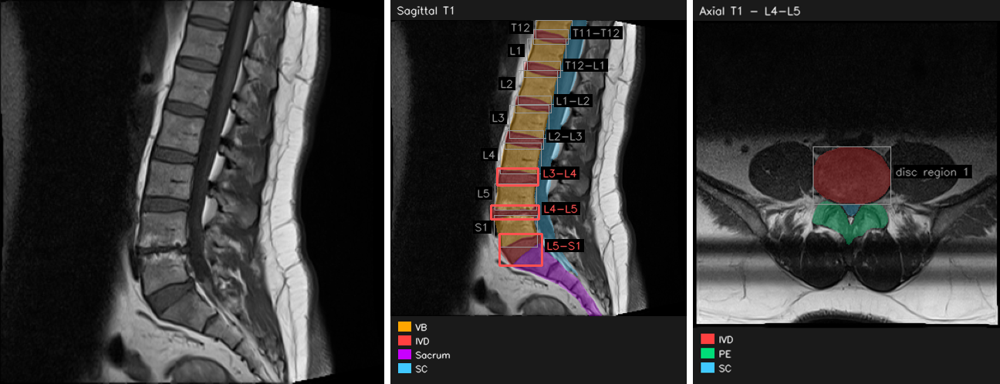

# Spinalyzer

Spinalyzer is a local web application for lumbar spine MRI. It segments the
vertebral column, measures each disc and vertebral body, grades disc
degeneration on the Pfirrmann scale, scores 36 structured radiological findings
and produces a PDF report. All processing runs on the local machine.

The models were trained on the LSMA-PQR dataset, which is the primary dataset
for this work: <https://github.com/farhatmasood/LSMA-PQR>.

<p align="center">
  
</p>
<p align="center"><em>Sagittal T1 input (left), sagittal segmentation with
level labels and the levels above the reporting threshold outlined (centre),
and an axial slice assigned to L4-L5 (right).</em></p>

> Research software. The output is not a medical diagnosis.

## Dataset

LSMA-PQR (Lumbar Spine Multi-view Annotations with Pfirrmann grading,
Quantitative measurements and structured Radiological reports) contains
4,120 T1- and T2-weighted lumbar MRI images (384 × 384) from 515 patients:
1,030 sagittal and 3,090 axial. It provides indexed segmentation masks,
Pfirrmann grades for the L3-L4, L4-L5 and L5-S1 discs, intervertebral disc
heights and structured radiology reports. The dataset is released under
CC BY 4.0.

- Repository: <https://github.com/farhatmasood/LSMA-PQR>
- Data: Mendeley Data, doi:[10.17632/p3r4xd2488.2](https://doi.org/10.17632/p3r4xd2488.2)
- Article: doi:[10.1007/s10278-026-02125-5](https://doi.org/10.1007/s10278-026-02125-5)

The images in `samples/` are taken from LSMA-PQR. Filenames follow the dataset
convention, in which `D3`, `D4` and `D5` denote the L3-L4, L4-L5 and L5-S1
disc levels.

## Models

| Component | Architecture | Input | Validation (stored with checkpoint) |
|---|---|---|---|
| Segmentation | DINOv2 ViT-B/14 (frozen) with LoRA (r = 16) and bottleneck adapters; separate axial and sagittal decoders | 384 × 384 | Dice 0.974 |
| Grading | DINOv2 ViT-B/14 with LoRA (r = 8); ordinal Pfirrmann head, stenosis head and per-disc pathology heads | 224 × 224 disc crop | Pfirrmann κ 0.585, accuracy 0.554 |
| Findings | ResNet-18 disc encoder with 4-head attention across the three lowest discs | 3 × 224 × 224 disc crops | weighted F1 0.585, macro F1 0.318 |

Segmentation classes are vertebral body, intervertebral disc, sacrum and spinal
canal on sagittal images, and intervertebral disc, posterior elements and
spinal canal on axial images.

The Pfirrmann head is ordinal. Four boundary logits $o_1,\dots,o_4$ give

$$P(\text{grade} > k) = \sigma(o_k), \qquad k = 1,\dots,4,$$

and the predicted grade is one plus the number of boundaries with
$\sigma(o_k) > 0.5$ (Frank and Hall, 2001). Only L3-L4, L4-L5 and L5-S1 were
graded in the training data, so other levels are segmented and measured but
not graded.

The trained weights are included in `checkpoints/` (Git LFS, about 0.9 GB).

## Installation

Python 3.10 or later. A CUDA GPU is recommended; the application also runs on
CPU.

```bash
git lfs install
git clone https://github.com/farhatmasood/spinalyzer.git
cd spinalyzer
```

If the repository was cloned without Git LFS, fetch the checkpoints with
`git lfs pull`.

```bash
conda create -n spinalyzer python=3.10 -y
conda activate spinalyzer
pip install torch torchvision --index-url https://download.pytorch.org/whl/cu121
pip install -r requirements.txt
```

For a CPU-only installation use `pip install torch torchvision`. Development
used PyTorch 2.5.1 with CUDA 12.1.

## Usage

```bash
python -m spinalyzer
```

Open <http://127.0.0.1:8000>. The three models load in about 20 seconds.
**Load sample study** in the interface analyses images from `samples/`.

| Option | Environment variable | Default |
|---|---|---|
| `--host` | `SPINALYZER_HOST` | `127.0.0.1` |
| `--port` | `SPINALYZER_PORT` | `8000` |
| | `SPINALYZER_CKPT_DIR` | `checkpoints/` |
| | `SPINALYZER_LEXICON` | `lexicon.json` |

### Loading a study

A study holds one to eight images of one patient: up to two sagittal (T1, T2)
and up to six axial (three per weighting). PNG, JPEG, BMP, TIFF, DICOM and
NIfTI files are accepted. Plane and weighting are read from the filename
(`sag`, `axial`, `T1`, `T2`) or from the DICOM series description; otherwise
the plane is inferred from the image shape. Both can be set by hand.

Each axial slice is assigned a disc level, together with the source of that
assignment:

| Source | Meaning |
|---|---|
| `filename` | the filename carries a level, e.g. `D4` or `L4-L5` |
| `manual` | set by the user in the alignment table |
| `order` | no level given; slices are mapped to the lowest levels in upload order |

### Commands

Commands are parsed with regular expressions over a fixed vocabulary.

| Command | Result |
|---|---|
| `segment L4` | highlights the L4 vertebral body |
| `segment L4-L5` | highlights the L4-L5 disc |
| `show the spinal cord` | highlights one anatomical class |
| `measure L5-S1` | disc height, AP diameter and area |
| `grade L4-L5` | Pfirrmann grade, stenosis and boundary probabilities |
| `find stenosis` | finding score and the levels involved |
| `locate stenosis` | marks the structure the finding refers to, per level |
| `compare L4-L5 and L5-S1` | side-by-side table |
| `describe` | study inventory |
| `help` | full command list |

Shortcuts can be defined in the interface, e.g. `g4 = grade L4-L5`; they are
stored in `lexicon.json`.

### Measurements

Measurements are reported in pixels unless the file carries a pixel size.
DICOM `PixelSpacing` and NIfTI voxel sizes are read automatically. For other
formats a value in mm per pixel can be entered under **Calibration**; it refers
to the original image, and the resize to the 384 × 384 segmentation grid is
accounted for:

$$s_{\text{grid}} = s_{\text{orig}} \cdot \frac{H_{\text{orig}}}{384}.$$

### Locating findings

None of the models predicts a bounding box. A finding is located by combining
(i) the disc level, taken from a per-level score of the grading model above
the threshold or from a level named in the finding itself (e.g. *L4-L5
Involvement*), with (ii) the segmented structure the finding refers to: the
disc for a bulge, the spinal canal for canal stenosis, the posterior elements
for facet hypertrophy and the adjacent vertebral bodies for Modic changes. The
drawn outline is therefore the segmentation of that structure, and the number
shown is the model score. Of the 36 findings, 20 map to a segmented structure,
8 name their own level, 7 have no segmented structure and 1 is scored for the
study only.

### Report

The PDF report contains the impression, the levels above the threshold, the
annotated images in a 2 × 4 plate, morphometry, grading, the findings table
and the acquisition details. Sections and annotation layers (class colours,
outlines, labels, measurements, positive levels only, legend) are selected in
the interface. The reporting threshold defaults to 0.50. A level is reported
as positive for Pfirrmann grade IV or V, stenosis above mild, a per-disc
pathology probability above the threshold, or a level-specific finding above
the threshold.

### HTTP API

Interactive documentation is served at `/api/docs`.

| Method | Path | Purpose |
|---|---|---|
| `GET` | `/api/health` | device, model status, limits |
| `POST` | `/api/study` | create a study from 1 to 8 images |
| `GET` | `/api/study/{id}` | study state |
| `POST` | `/api/study/{id}/level` | assign an axial slice to a level |
| `POST` | `/api/study/{id}/calibrate` | set mm per pixel |
| `POST` | `/api/study/{id}/ask` | run a command |
| `POST` | `/api/study/{id}/locate` | locate a named finding |
| `GET` | `/api/findings` | finding catalogue |
| `POST` | `/api/study/{id}/report/preview` | render report images |
| `POST` | `/api/study/{id}/report.pdf` | build the PDF report |
| `GET`, `POST` | `/api/lexicon` | user-defined shortcuts |

Studies are kept in memory for four hours.

## Tests

```bash
python -m pytest
```

`tests/test_units.py` and `tests/test_locate.py` cover filename parsing, level
labelling, scaling, command parsing and finding resolution.
`tests/test_inference.py` runs the full pipeline on the sample images with the
released checkpoints and is skipped when the checkpoints are not present.

## Repository structure

```
spinalyzer/
  __main__.py       server entry point
  app.py            HTTP routes
  engine.py         checkpoint loading, image reading, inference
  study.py          studies, series, level alignment, measurements
  commands.py       command parser and actions
  findings.py       finding localisation
  render.py         image annotation
  report.py         PDF report
  models/           segmentation, grading and findings networks
  static/           web interface
checkpoints/        trained weights (Git LFS)
samples/            example images from LSMA-PQR
assets/             figure used in this README
tests/              unit and end-to-end tests
```

## Citation

If you use this software, please cite the LSMA-PQR dataset and article:

```bibtex
@article{Masood2026LSMAPQR,
  author    = {Masood, Rao Farhat and Taj, Imtiaz Ahmad},
  title     = {{LSMA-PQR}: A Comprehensive Dataset of Lumbar Spine Multi-View Annotations with Pfirrmann Grading, Quantitative Measurements, and Structured Radiological Reports},
  journal   = {Journal of Imaging Informatics in Medicine},
  year      = {2026},
  publisher = {Springer},
  doi       = {10.1007/s10278-026-02125-5}
}

@dataset{Masood2025LSMAPQRData,
  author    = {Masood, Rao Farhat and Taj, Imtiaz Ahmad and Talha, Muhammad and Khan, M. Babar},
  title     = {{LSMA-PQR}: Lumbar Spine Multi-view Annotations with Pfirrmann grading, Quantitative measurements and structured Radiological reports},
  year      = {2025},
  publisher = {Mendeley Data},
  version   = {V2},
  doi       = {10.17632/p3r4xd2488.2}
}
```

## References

1. Masood, R. F. (2026). *PC-RadNet*. GitHub repository.
   <https://github.com/farhatmasood/pc-radnet>
2. Oquab, M. et al. (2024). DINOv2: Learning robust visual features without
   supervision. *Transactions on Machine Learning Research*.
3. Hu, E. J. et al. (2022). LoRA: Low-rank adaptation of large language models.
   *ICLR 2022*.
4. He, K., Zhang, X., Ren, S., and Sun, J. (2016). Deep residual learning for
   image recognition. *CVPR*, 770–778.
5. Frank, E., and Hall, M. (2001). A simple approach to ordinal classification.
   *ECML*, LNCS 2167, 145–156.
6. Pfirrmann, C. W. A., Metzdorf, A., Zanetti, M., Hodler, J., and Boos, N.
   (2001). Magnetic resonance classification of lumbar intervertebral disc
   degeneration. *Spine*, 26(17), 1873–1878.

## License

The code is released under the MIT License (see `LICENSE`). The LSMA-PQR
images in `samples/` are distributed under CC BY 4.0.
